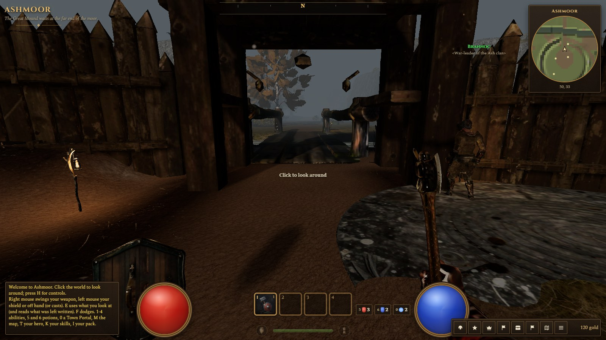
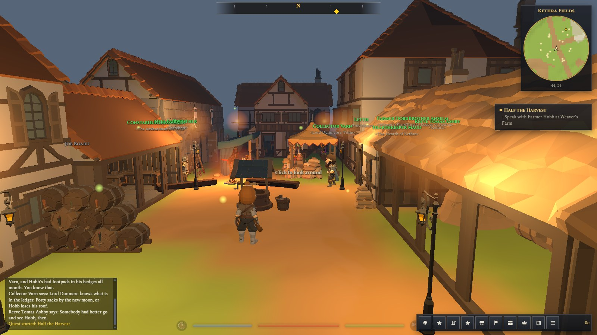
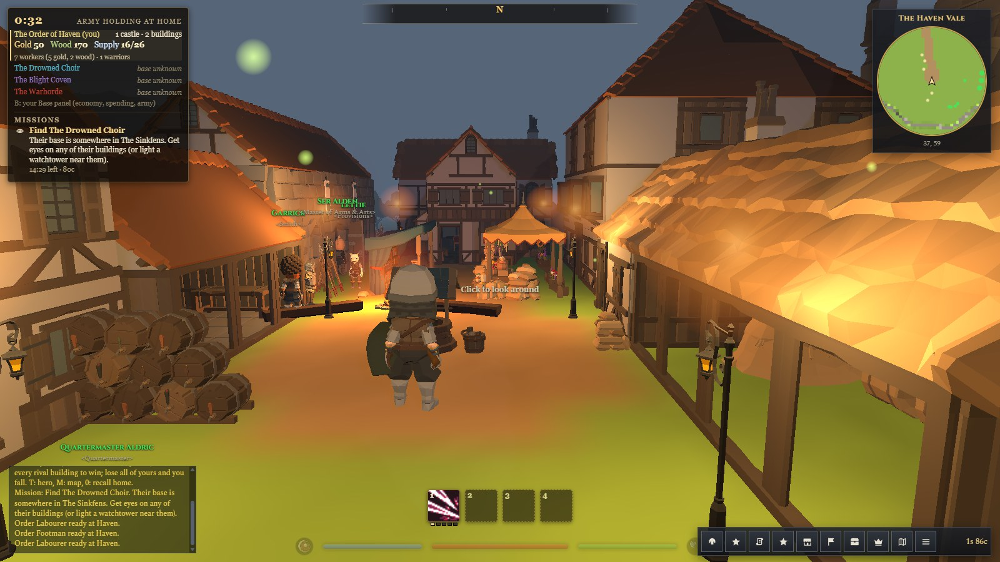
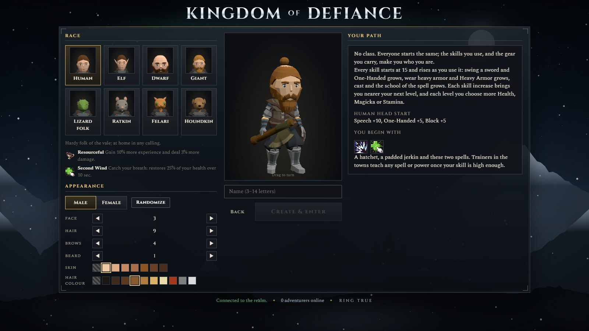
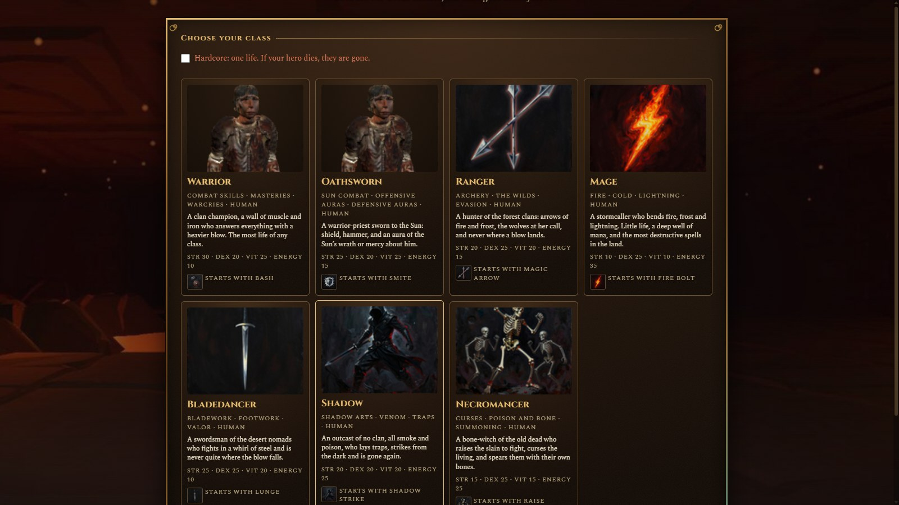
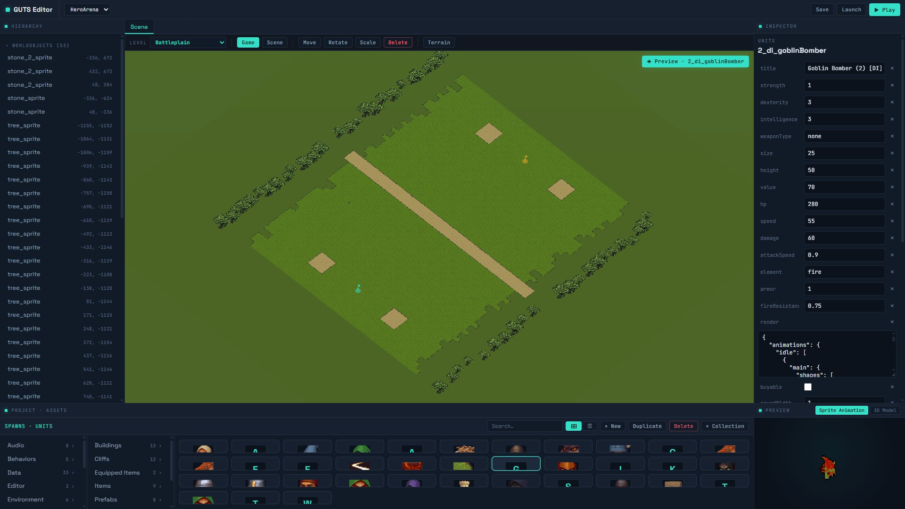
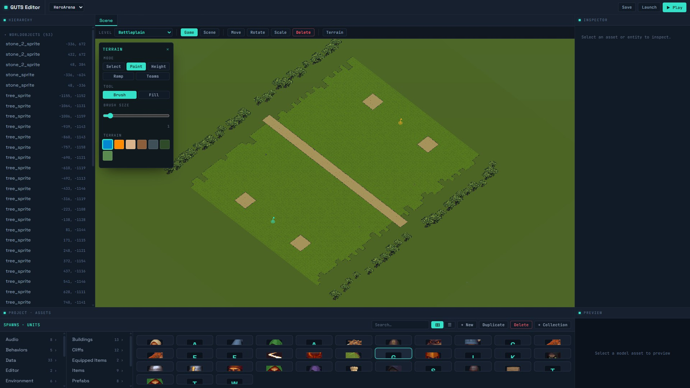

<p align="center">
  
</p>

<h3 align="center">Gamedev Ultimate Toolkit System</h3>

<p align="center">
  A data-driven JavaScript game engine, editor and build CLI, from single-player prototypes to persistent multiplayer worlds.
</p>

<p align="center">
  <a href="LICENSE"></a>
  
  
  
</p>

<p align="center">
  <a href="#quick-start">Quick start</a> ·
  <a href="docs/getting-started.md">Tutorial</a> ·
  <a href="docs/concepts.md">Concepts</a> ·
  <a href="global/README.md">Kits</a> ·
  <a href="docs/editor.md">Editor</a> ·
  <a href="#made-with-guts">Games</a>
</p>

---

GUTS is an entity component system with typed-array storage, Three.js rendering, and
multiplayer built in. Game content (units, items, levels, scenes, components) is JSON; behavior
is small systems that read and write it. The same project builds into a browser client, a Node
server, a headless simulation and an editor.

## Features

|   |   |
|---|---|
| **ECS** | Schema-defined components stored in typed arrays. Systems talk through named services instead of imports, so any system can be replaced by a project file of the same name. |
| **Core** | Rendering, post-processing, lighting, terrain and world, cameras (free, orthographic, third person), animation, particles and effects, audio and music, scenes, loading, UI, chat. |
| **Kits** | Twelve optional packs, from behavior-tree AI and grid pathfinding to a streamed continent, quests, action-RPG combat, Diablo-style loot and Rapier physics. A game lists the ones it uses. |
| **Multiplayer** | Server-authoritative persistent worlds (`MultiplayerHost`, interest-managed snapshots, client interpolation) or deterministic lockstep for RTS matches, with a desync debugger. |
| **Four builds** | Browser client, Node server, headless simulation (AI-vs-AI batches) and editor, all from one codebase. |
| **Editor** | Edits every collection, with modules for terrain, models, sprites, particles, audio, behavior trees, bone attachments and simulations. Themeable. |
| **CLI** | `guts new`, `guts dev` with live reload, production builds, and `guts fork-diff` to see how a game's engine overrides drift from upstream. |

## Quick start

Needs Node.js 20 or newer.

```bash
npx github:Seeders/GUTS new my-game     # --template game (default) or app
cd my-game
npm install
npm run dev                              # http://localhost:3000/
```

Then follow **[Getting started](docs/getting-started.md)**: add a component, a system and a
service to the starter project in about ten minutes.

## Kits

The core is enough for a small game. Kits add the rest; list them in `game.json`
(`{ "kits": ["combat"] }`) and their dependencies come along. Each kit's README lists its
systems, the services they provide, and what a game must supply.

| Kit | What it's for | Needs |
|---|---|---|
| [ai](global/kits/ai/README.md) | Behavior trees and the system that runs them | |
| [units](global/kits/units/README.md) | Grid map, spatial queries, A* pathfinding, steering, units from prefabs, vision | ai |
| [combat](global/kits/combat/README.md) | Damage, armor and resistances, projectiles, death, health bars, damage numbers | ai, units |
| [rts](global/kits/rts/README.md) | Squad orders, building placement, fog of war, minimap, lockstep networking, AI-vs-AI simulations | units |
| [cards](global/kits/cards/README.md) | Deck, dragging, card rendering | |
| [multiplayer](global/kits/multiplayer/README.md) | Persistent world: sessions and saving, server-checked movement, snapshots and events, client mirror | |
| [world](global/kits/world/README.md) | A continent of chunks shared by server and client: walk height, water, collision, zones, paths, streaming | |
| [social](global/kits/social/README.md) | Parties, chat channels, trading, the world's saved flags | |
| [quests](global/kits/quests/README.md) | Quests and objectives, NPCs with routines, dialog, vendors, story quests with journal and compass | world, social |
| [rpg](global/kits/rpg/README.md) | Action-RPG combat, creature camps, skills that rise with use, talents, parties | world, social |
| [loot](global/kits/loot/README.md) | Rarities, affixes, uniques and sets, sockets and runewords, drop tables, ground drops, grid inventories | |
| [physics](global/kits/physics/README.md) | Rapier bodies, joints, character controllers, raycasts, explosions, ragdolls and debris | |

More in **[Engine core and kits](global/README.md)**.

## Documentation

| | |
|---|---|
| [Getting started](docs/getting-started.md) | Tutorial on the starter project |
| [Concepts](docs/concepts.md) | Entities, components, systems, services, scenes, collections, configs, builds, multiplayer, performance |
| [Engine core and kits](global/README.md) | What the engine ships, what each kit needs, overriding engine files, adding a kit |
| [Editor](docs/editor.md) | Running the editor, its layout, writing modules, attaching equipment to bones |
| [Probes](tools/probes/README.md) | Deterministic before/after checks that a change didn't alter a multiplayer game's behavior |

## The `guts` command

| Command | Description |
|---------|-------------|
| `guts new <folder> [--template game\|app]` | Create a project from a template |
| `guts dev [--port n] [--no-serve]` | Build, rebuild on change, serve with live reload |
| `guts build [--target client\|server\|headless\|editor] [--production] [--watch] [--strict]` | Build the project in this folder |
| `guts fork-diff <projects...> [--out report.md]` | List engine files a project replaces and how they differ |

A persistent multiplayer game's `server.js` is a single call:

```js
import { startMultiplayerServer } from 'guts/engine/MultiplayerHost.js';

startMultiplayerServer({ root: __dirname, name: 'my-world', title: 'My World', port: 3002 });
```

## Made with GUTS

- **[TurnBasedWarfare](https://github.com/Seeders/TurnBasedWarfare)**: RTS auto-battler with
  placement and battle phases, behavior-tree AI, abilities, server-authoritative multiplayer and
  headless AI-vs-AI simulations.
- **The Descent**: first-person action RPG in a grim
  Iron Age, with outdoor acts, enterable dungeons, rolled loot and ragdolls.
- **Kingdom of Defiance**: open-world RPG with story
  quests, NPC routines and real-time combat.
- **Age of Defiance**: faction war with RTS-style bases in a
  persistent world.
- **World of Defiance**: online RPG with zones, camps and
  quests.

The Defiance games share the multiplayer, world, quests, rpg and social kits; each keeps only
what it does differently.

## Screenshots

<table>
  <tr>
    <td width="50%"><br><sub><b>The Descent</b>: first-person, Ashmoor's gate</sub></td>
    <td width="50%"><br><sub><b>Kingdom of Defiance</b>: a village with NPCs, quests and dialog</sub></td>
  </tr>
  <tr>
    <td><br><sub><b>Age of Defiance</b>: a hero and their base's economy and missions</sub></td>
    <td><br><sub><b>Kingdom of Defiance</b>: character creator</sub></td>
  </tr>
  <tr>
    <td><br><sub><b>The Descent</b>: choosing a class</sub></td>
    <td><br><sub><b>TurnBasedWarfare</b></sub></td>
  </tr>
  <tr>
    <td><br><sub><b>Editor</b>: level in the 3D viewport, a unit in the inspector and preview</sub></td>
    <td><br><sub><b>Editor</b>: terrain painting</sub></td>
  </tr>
</table>

## Repository layout

```
GUTS/
├── bin/guts.js          the guts command
├── build/               build system: collection discovery, entry generation, webpack, fork-diff
├── engine/              runtime entry points: client, server, headless, MultiplayerHost, editor shell
├── global/              engine collections: core (collections/) and kits (kits/)
├── templates/           starter projects for guts new (game, app)
├── tools/probes/        deterministic behavior probes for multiplayer games
├── deploy/              gutsengine.app: nginx, game gateway, deploy script
├── docs/                documentation
└── projects/Editor/     the editor; other projects are cloned into projects/ from their own repos
```

## Working on GUTS itself

```bash
git clone https://github.com/Seeders/GUTS.git
cd GUTS
npm install
npm run start:editor     # editor, http://localhost:8080/index.html
npm test                 # engine and editor tests
```

To try engine changes in a project, point the project at your clone
(`npm install ../GUTS` in the project) and run `guts dev` there.

## Contributing

Bug reports, feature requests and pull requests are welcome via
[GitHub Issues](https://github.com/Seeders/GUTS/issues). Games made with GUTS are welcome too.

## License

MIT, see [LICENSE](LICENSE).
